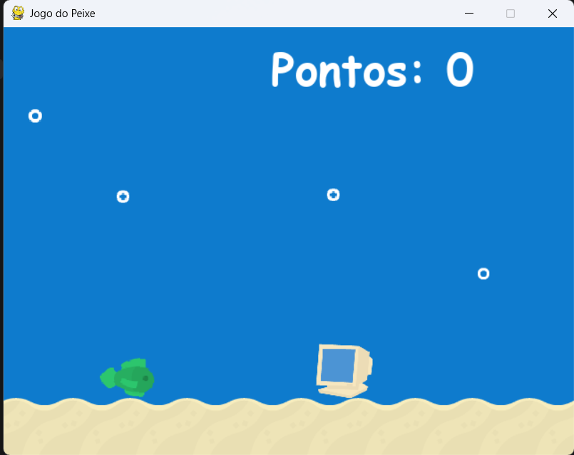

# Jogo Peixe
Jogo inspirado no Dinossaura do Google utilizando visão computacional
O jogo foi feito utilizando a linguagem Python, utilizando a biblioteca Pygame, assim como seu algoritmo de visão computacional que foi feito com uso da biblioteca OpenCV.

